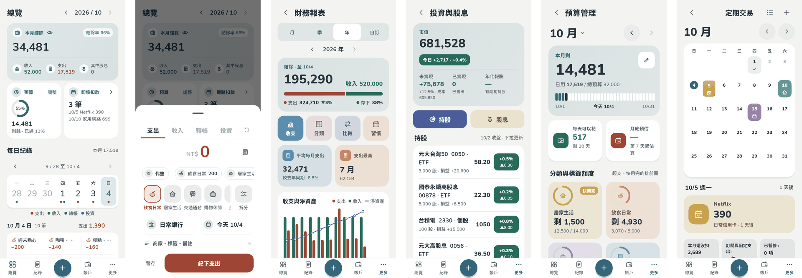

# 記帳本

一個只為自己做的 Android 記帳 App：記帳、信用卡、台股與股息、預算、定期扣款都在同一本帳裡。資料只存在你的手機上，整本加密，不需要註冊帳號。



## 能做什麼

- **記一筆很快**：支出、收入、轉帳、投資四個分頁；常用的組合一點帶入；可以拆成好幾個分類、代墊給朋友、拍收據、掃紙本發票的 QR Code。
- **看得懂錢去哪**：總覽一眼看本月結餘、預算與即將扣款；財務報表有收支、分類、比較、習慣四種看法。
- **信用卡照帳單算**：結帳日、繳款日、分期、回饋與額度使用率，跟銀行帳單對得起來。
- **台股與股息**：買賣、配股、減資、二代健保，收盤價每天從證交所、櫃買中心更新；每一檔有走勢圖，股息會推估未來 12 個月。
- **預算與定期扣款**：每月預算與月底預估；訂閱、房租、保險到期自動入帳，好幾天沒開 App 也會一期一期補記。
- **提醒與小工具**：到期提醒、每日記帳提醒、Google 日曆，桌面小工具看本月花費。
- **匯入匯出**：CSV、財政部電子發票，下載的紀錄可以完整匯回。

## 資料與隱私

- 帳本以 SQLCipher 加密，只存在手機上；可以設密碼、指紋，也可以不設。
- 備份都是加密檔：Google 雲端硬碟（帳本有變就每天一份，收據照片可選）、手機上的資料夾（每天或每週）；另外 Android 自己的備份會在背景帶一份帳本，換手機或重裝時歡迎頁會問要不要還原。
- App 只連這幾個地方：證交所與櫃買中心（收盤價）、臺灣銀行（匯率）、GitHub（檢查新版），以及你開啟的 Google 雲端硬碟備份。帳本內容不會送給任何人。

## 安裝與更新

1. 在手機上打開 [下載頁](https://github.com/swz0103/ExpenseTracker-V2/releases/tag/android-latest)，下載 `ExpenseTracker.apk` 並安裝（第一次要允許從瀏覽器安裝）。
2. 之後的新版在 App 裡更新：「設定 › 關於」，或打開 App 時的提示。
3. 想先試試看：下載頁的 `test-ledger.etbk` 是半年份的範例帳本，在歡迎頁選「還原備份」，密碼 `test1234`。

需要 Android 7.0 以上、64 位元（arm64）的手機。

## 開發

Flutter 寫成，依功能分成 App、基礎設施（加密、儲存、行情）與規則套件。現況與待辦見 [docs/STATUS.md](docs/STATUS.md)，文件導覽見 [docs/README.md](docs/README.md)，架構見 [ADR-0001](docs/adr/0001-target-architecture.md)。

```powershell
./tooling/run-host-checks.ps1 -Package all
```

每個模組會依序跑 `pub get --enforce-lockfile`、格式檢查、`analyze` 與測試；CI 另外建 APK、網頁預覽、每頁截圖，並在模擬器量測速度。沒有 Flutter SDK 時，把分支推到 `tools/<名稱>`，`Flutter tools` 工作流程會更新 `pubspec.lock` 並排版到 `tools/<名稱>-done`。
