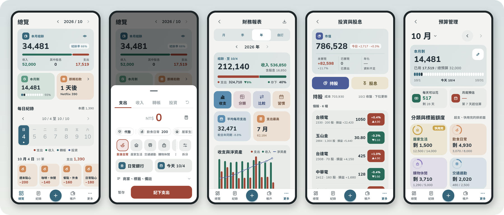
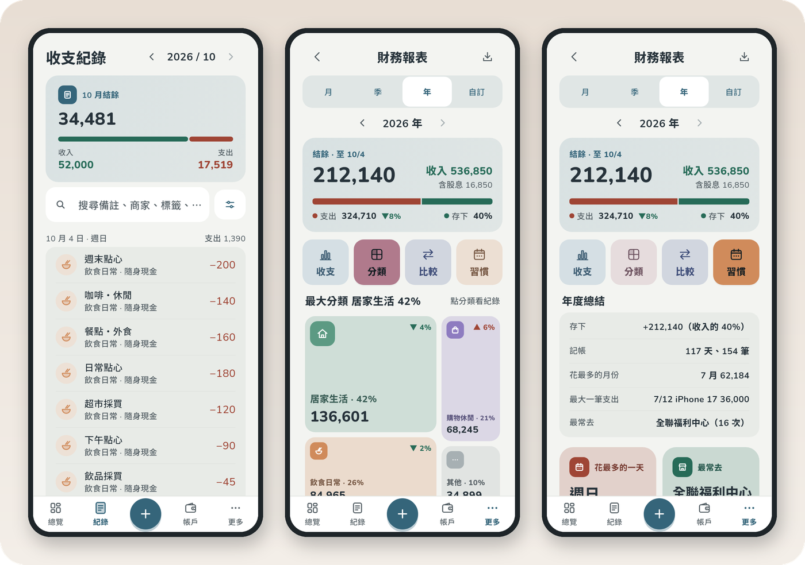
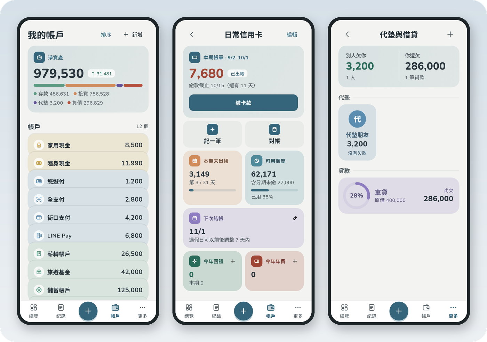
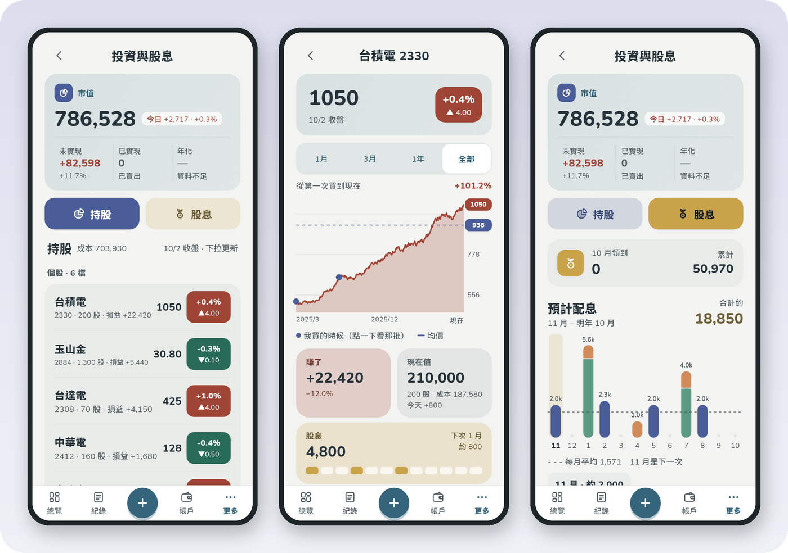
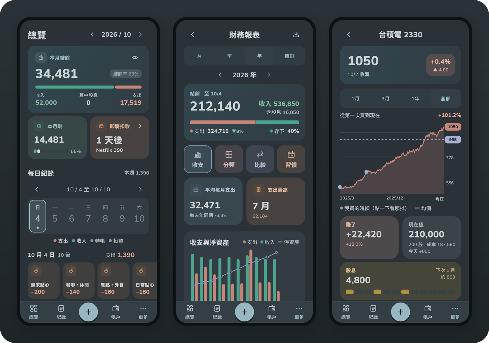

# 記帳本

一個 Android 記帳 App：日常花費、信用卡、台股與股息、預算、定期扣款，都記在同一本帳裡。資料只存在你的手機，整本加密，不用註冊帳號。

**[下載最新版](https://github.com/swz0103/ExpenseTracker-V2/releases/latest)** · [安裝說明](#安裝與更新) · [資料與隱私](#資料與隱私)

## 記帳與報表

記一筆有支出、收入、轉帳、投資四個分頁，常用的組合點一下就帶入。一筆可以拆成好幾個分類，也能標成代墊、附上收據照片，或掃紙本發票的 QR Code。

總覽一眼看到本月結餘、預算剩多少、哪天要扣款。財務報表分成收支、分類、比較、習慣四種看法，可以按月、季、年或自訂期間看。

  

## 帳戶、信用卡與代墊

現金、電子支付、銀行、信用卡分組排好，淨資產一目了然。信用卡依結帳日與繳款日算帳單，分期、回饋、年費、額度使用率都對得上銀行帳單。幫朋友付的錢、借出去或貸款，都有自己的頁面追蹤。

  

## 台股與股息

記買進、賣出、配股、減資，自動算手續費、證交稅與二代健保。收盤價每天從證交所、櫃買中心更新。每一檔都有走勢圖，標出你每次買進的位置；股息會推估未來 12 個月。

  

## 預算與定期扣款

每月預算可以分到分類與標籤，看每天還能花多少、月底大概會剩多少。訂閱、房租、保險這類固定支出到期會自動入帳，好幾天沒開 App 也會一期一期補記。

  

## 深色模式

跟著手機切換，也可以自己選。深色下的文字與色塊都調得比較柔和，晚上看不刺眼。

  

## 還有

- **提醒**：信用卡與定期扣款到期提醒、每日記帳提醒，也可以同步到 Google 日曆。
- **桌面小工具**：不用打開 App 就能看本月花費。
- **匯入匯出**：CSV 與財政部電子發票；匯出的紀錄可以完整匯回。

## 資料與隱私

- 帳本以 SQLCipher 加密，只存在手機上；可以設密碼、指紋，也可以不設。
- 備份都是加密檔，可以存到 Google 雲端硬碟（帳本有變動就每天一份，收據照片可選），或手機上的資料夾（每天或每週）。Android 系統備份也會在背景帶一份，換手機或重裝時，歡迎頁會問要不要還原。
- App 只連這幾個地方：證交所與櫃買中心（收盤價）、臺灣銀行（匯率）、GitHub（檢查新版），以及你開啟的 Google 雲端硬碟備份。帳本內容不會送給任何人。

## 安裝與更新

1. 在手機上打開 [下載頁](https://github.com/swz0103/ExpenseTracker-V2/releases/latest)，下載 `ExpenseTracker-版號.apk` 並安裝。第一次安裝要允許從瀏覽器安裝 App。
2. 之後有新版時，App 打開會提示，也可以到「設定 › 關於」更新。
3. 想先試試看：下載頁的 `test-ledger.etbk` 是五年份、約 8,000 筆的範例帳本。在歡迎頁選「還原備份」，密碼是 `test1234`。

需要 Android 7.0 以上、64 位元（arm64）的手機。

## 授權

[GPL-3.0](LICENSE)：可以使用、修改、再發布；改過後再發布，要用同樣的授權並公開原始碼。另附一條附加許可（[LICENSE-EXCEPTION.md](LICENSE-EXCEPTION.md)），允許與 Google Play 服務等 Android 平台的非自由程式庫一起發布。字型 Nunito 與 Noto Sans TC 依 SIL Open Font License（`apps/expense_tracker/fonts/OFL-*.txt`）。
