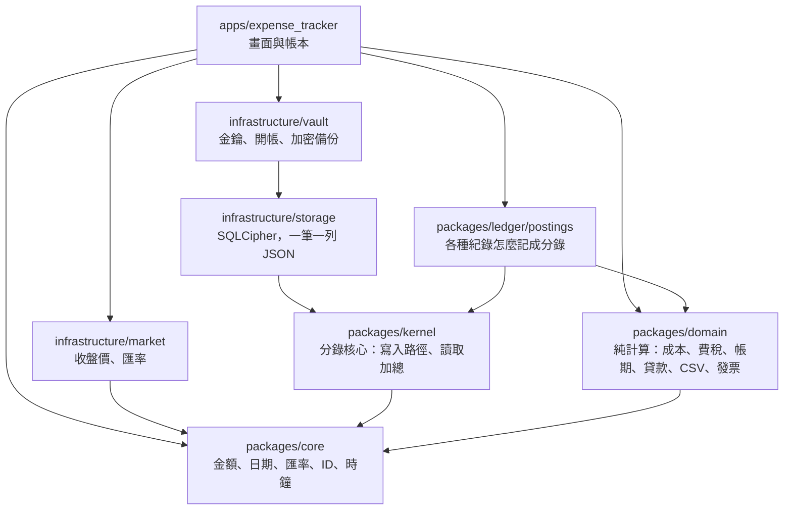
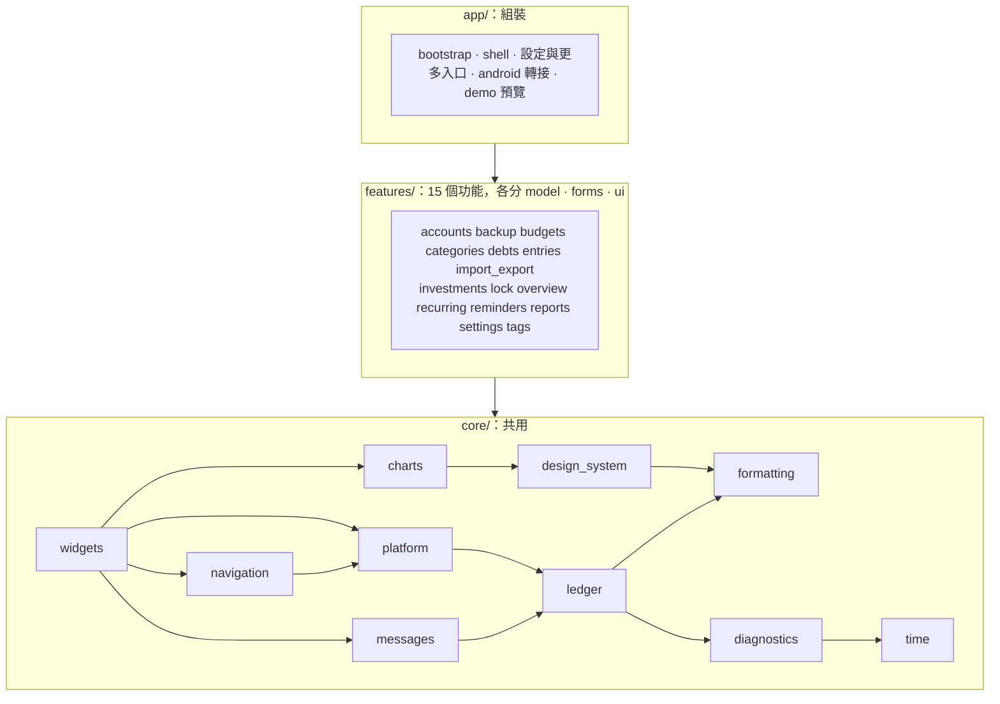
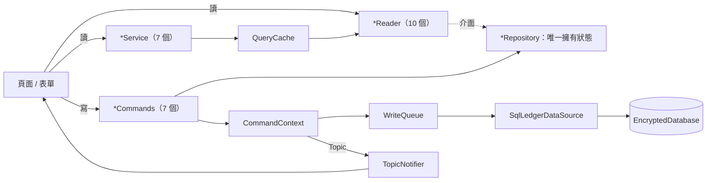

# 架構

> 程式分成哪些模組、App 內怎麼分層、帳本怎麼組成、資料怎麼讀寫與保存。每條依賴規則都由測試守住，見最後一節。

## 模組

`packages/*` 是純 Dart、不碰平台；不需要帳本狀態的計算一律放 `domain`，App 只呼叫。

## App 內部分層

| core 部分 | 內容 | 可以用 |
| --- | --- | --- |
| `formatting/` | 金額、日期、共用詞彙 `Words`、`JsonFields`；純函式 | — |
| `time/` | `AppClock`：讀時間的唯一地方 | — |
| `diagnostics/` | `ErrorLog`（去識別化、堆疊、批次寫入）、`UnhandledErrors`（未處理錯誤）、`ErrorSteps`、`PerformanceMonitor` | time |
| `design_system/` | 顏色 `AppColors`、字級、圖示、動態、面板；`components/` 不知道帳本 | formatting |
| `charts/` | 圖表 | design_system、formatting |
| `ledger/` | 帳本，見下一節；Flutter 只用 `foundation`（ADR-0012） | formatting、diagnostics、time |
| `platform/` | 偏好設定、背景同步工作、開帳、隱私 | ledger、formatting、diagnostics、time |
| `messages/` | 告訴使用者的帳本數值與問題，以及手機回覆的結果（掃描、檢查更新） | ledger、formatting、platform |
| `navigation/` | `Nav`、`AppRoute`、`AppRoutes`、`openFullScreen` | ledger、platform |
| `widgets/` | 認得帳本的共用元件：紀錄列、選擇器、計算機 | 以上全部 |

功能裡：`model/` 是資料與計算（不碰畫面，只拿帳本中用到的部分，ADR-0013）；`forms/` 是表單與面板，別的功能可以打開；`ui/` 是頁面，只給自己和 `app/` 用。功能之間不能互相需要（含間接）。規則的唯一來源是 `test/support/layout.dart`。

導覽：每頁是一個 `AppRoute`，`Nav.open` 打開、`app/shell.dart` 決定畫哪頁，返回跟著 `AppRoute.parent`；整頁工作（排序、匯入）用 `openFullScreen`，全 App 唯一自己推路由的地方。表單用底部面板 `showSheet`，選擇器用中間面板 `showPanel`。

## 帳本（core/ledger）

| 層 | 是什麼 | 成員 |
| --- | --- | --- |
| `models/` | 不可變的資料型別，一型別一檔 | Account Category Entry Holding Budget Recurring Trashed |
| `repositories/` | 唯一擁有一種紀錄的狀態；對外只給 `*Reader` | entries accounts categories holdings budgets recurring trash marketData receipts drafts |
| `services/` | 只讀、跨 Repository 的計算，經 `QueryCache` 記住答案 | balance statement report entryQuery budget recurring · entryValidator |
| `commands/` | 寫入；跨 Repository 的修改用 `UnitOfWork` 一次交出 | entry account category budget recurring holding attachment |
| `cache/` | `Topic`（資料主題）、`TopicNotifier`、`QueryCache`（讀了哪些主題自動追蹤，主題變了才作廢） | — |
| `journal/` | 分錄（工作包 2.0）：紀錄對應成意圖（`BookMapping`，舊資料形狀 `OldShape`）、整本重放（`replayBook`）、與現行數字比對（`checkParity`）、需要使用者檢視的舊形狀紀錄（`recordsNeedingReview`，D47） | models、cache、repositories、services |
| `persistence/` | `WriteBatch`、`UnitOfWork`、`WriteQueue`、`SqlLedgerDataSource`、紀錄版本與升級、一型別一檔的 JSON；`JournalKeeper` 讓分錄跟著紀錄 | — |
| `ledger.dart` | 只做組合與通知：`today` `newId` `watch(topics)` `settled` `problem` `amounts` | — |

依賴只往下：models ← cache ← repositories ← services ← journal ← commands；不用 `part`。

**一筆寫入怎麼走**：`entryCommands.add(e)` → `entries.add` → `holdings.replay`（股數不夠就還原並丟出）→ `CommandContext` 通知 `Topic.entries` 等主題、交出 `WriteBatch` → `WriteQueue` 依序 `keep` 成資料庫一個交易。畫面先生效；寫入失敗時 `problem` 變成 `KeepFailed`，佇列清空後整本重讀，畫面回到實際存下的狀態。

**分錄跟著紀錄（2.0）**：紀錄仍是唯一真相、寫入仍走上面那條路；分錄是由紀錄算出、可整批重建的索引，存在同一個加密檔的衍生資料表（`posting`、`month_sum`…，不進備份）。開帳時若分錄不是由這一版規則、這一個 `revision` 算出（例如舊版 App 寫過紀錄，D49），就在 worker isolate 上整本重放（開帳時與讀帳同一趟：`book_opening.dart`、`journal_rebuild.dart`、`EncryptedDatabase.workApart`，D51），畫面所在的 isolate 只等待；分類帳戶以分類代號為準（D88），股數與 App 同精度（D87）；每次 `keep` 之後，`JournalKeeper` 把變動的紀錄記成分錄，再在背景比對畫面上的數字（餘額、每月收支與分類、持股、卡費、各幣別為零），不同就寫進診斷紀錄（只寫哪種數字，不寫金額）。畫面還沒有讀分錄。

**一次讀取怎麼走**：`balanceService.balance(id)` 先查 `QueryCache`；沒有時計算，計算中讀過的 `Reader` 自動回報主題（`entries`、`accounts`）。之後只有這些主題變動才重算；改預算不會讓餘額重算。

## 資料格式與升級

- 每列 JSON 帶 `_v`；新欄位一律選填、有預設值。改存法時寫升級函式，開帳時在**一個交易**裡完成，失敗整個還原。
- 版本 2 起紀錄、預算、定期、回收區、拆帳以**分類 id** 存放，分類改名只寫一列（`category_id_migration.dart`）。
- 每個版本留一份它寫出的帳本與備份，每次變更都用密碼打開、還原、比對（ADR-0010）。

## 金鑰與備份

| 項目 | 做法 |
| --- | --- |
| 加密 | SQLCipher；資料金鑰由密碼（Argon2id）、救援碼、指紋金鑰分別包裝，或免密碼存在私有資料夾 |
| 備份格式 | v3：分塊、gzip、AES-256-GCM，AAD 綁定標頭雜湊與塊序；還原前先寫暫存庫檢查 |
| Android 系統備份 | 只帶 `files/cloud/` 的加密帳本，給換手機時還原（ADR-0005） |
| 雲端硬碟 | `drive.file` 權限，有變就每天一份，留最新 5 份；收據照片另外開 |
| 手機資料夾 | 使用者選的資料夾，每天或每週，留最新 5 份 |
| 背景 | 離開時把加密備份放進 `outbox/`，`BackupWorker` 不需金鑰就能送出 |

細節：`infrastructure/vault/README.md`、[android.md](android.md)。

## 外部資料

每種資料一個免費、免帳號的來源；查不到就說查不到，舊值標示日期。

| 資料 | 來源 |
| --- | --- |
| 上市收盤 | 證交所 `STOCK_DAY_ALL`，缺時 `STOCK_DAY` 月報 |
| 上櫃收盤 | 櫃買中心每日收盤 |
| 走勢圖 | 證交所、櫃買月報，讀過的月份存在 `prices/` |
| 匯率 | 臺灣銀行牌告 CSV；`FxRate` 存整數比例，最後才取位 |

不做盤中行情：正式來源要付費簽約。

## 由測試守住的規則

| 規則 | 在哪 |
| --- | --- |
| core 各部分、功能之間、帳本內部的依賴方向；只有 `openFullScreen` 推路由；範例帳本只在 `app/demo/` | `test/rules/layers_test.dart` |
| 色碼、字級數字、轉型、依賴整本帳本的檔數（模型為 0） | `tooling/architecture_checks/test/app_syntax_test.dart` |
| 設計系統：按鈕、退場元件、字級縮放、圓角與間距、動畫、共用詞 | `tooling/architecture_checks/test/app_design_syntax_test.dart` |
| 每頁 48 dp、有名稱、念成按鈕就按得下；200% 字級不溢出 | `test/rules/accessibility_test.dart`、`layout_*_test.dart` |
| 捕捉的錯誤要記錄或說明；訊息不含原始例外 | `test/rules/error_rules_test.dart` |
| 舊名稱不回來 | `test/rules/naming_test.dart` |
| 檔案、函式長度（參考值，超過要標明） | `layers_test`、`code_size_test` |
| 從未被測試執行的類別與函式只准變少 | `bin/declaration_coverage.dart`（CI） |
| 被排除在分析之外的路徑都有 PR 檢查 | `exclusions_test` |
| 套件不碰平台、lockfile 一致、文件連結與路徑有效 | `tooling/architecture_checks` |
